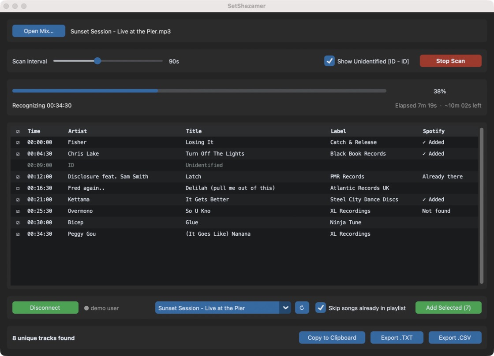

# SetShazamer

**Turn a long DJ mix into a timestamped tracklist, then send the tracks you like to a Spotify playlist.**

Drop in a 2-hour set (`.mp3`, `.mp4`, `.m4a`, `.wav`, `.flac`, `.mkv`…), or paste a
**YouTube or SoundCloud link** and let SetShazamer download it as an MP3. SetShazamer
fingerprints a short slice every 30–180 seconds with Shazam, merges the repeat matches
into one row per track, and gives you a clean tracklist:

```
[00:00:00] | Fisher - Losing It (Catch & Release)
[00:04:30] | ID - Unidentified
[00:06:00] | Chris Lake - Turn Off The Lights (Black Book Records)
[00:10:30] | Disclosure feat. Sam Smith - Latch (PMR Records)
```



## Features

- **Paste a link.** YouTube and SoundCloud links (and most other sites [yt-dlp](https://github.com/yt-dlp/yt-dlp)
  supports) are downloaded as MP3 to `~/Music/SetShazamer`, then scanned automatically.
- **Handles long, heavy files.** Audio is decoded slice by slice through ffmpeg pipes, so
  it never loads the whole file into memory or writes temp files. Video files work too.
- **One row per track.** Repeat matches of the same song are merged, including
  "Original Mix" / "Extended Mix" / "feat." variants. The timestamp is where the track starts.
- **Optional ID rows.** Two or more unrecognised slices in a row show up as `ID - Unidentified`,
  which usually means an unreleased track or a long blend.
- **Metadata:** artist, title, label, album, ISRC, plus Apple Music, Spotify and Shazam links.
- **Spotify:** tick the tracks you want, then add them to an existing playlist or a new one.
  Songs already in the playlist are skipped.
- **Export:** copy to clipboard, `.txt` (YouTube / 1001Tracklists timestamp format) or `.csv`.
- **Responsive:** the scan runs in the background with live progress, a time-remaining
  estimate and a Stop button that takes effect immediately.

---

## Install

### Option A: download the app (Apple Silicon Macs)

1. Install FFmpeg, which SetShazamer uses to read audio. With [Homebrew](https://brew.sh):
   ```bash
   brew install ffmpeg
   ```
2. Download `SetShazamer-macOS-arm64.zip` from the
   [latest release](../../releases/latest), unzip it, and drag **SetShazamer.app** into
   **Applications**.
3. The app isn't signed with an Apple Developer ID, so macOS blocks it the first time.
   Either:
   - open it once, then go to **System Settings → Privacy & Security** and click
     **Open Anyway**, or
   - run this in Terminal:
     ```bash
     xattr -dr com.apple.quarantine /Applications/SetShazamer.app
     ```

The download only runs on Apple Silicon (M1 or later). On an Intel Mac, use Option B.

### Option B: build it yourself (any Mac)

You need Python 3.11+ with Tk, and FFmpeg:

```bash
brew install ffmpeg python@3.12 python-tk@3.12
git clone https://github.com/chazarena/SetShazamer.git
cd SetShazamer
./build_mac.sh
```

`build_mac.sh` creates a clean virtual environment, builds `SetShazamer.app` with
PyInstaller, signs it ad hoc, and copies it into `/Applications`. Use
`./build_mac.sh --no-install` to leave the result in `./dist` instead.

### Option C: run from source (macOS, Windows, Linux)

```bash
python3 -m venv .venv
source .venv/bin/activate          # Windows: .venv\Scripts\activate
pip install -r requirements.txt
python app.py
```

FFmpeg has to be installed and on your `PATH`. On Windows: `winget install Gyan.FFmpeg`.
On Linux: `sudo apt install ffmpeg python3-tk`.

---

## Using it

1. Either:
   - click **Open Mix…** and pick a file. On a Mac you can also drop the file on the
     Dock icon or use **Open With → SetShazamer**, or
   - paste a YouTube or SoundCloud link into the box under it and click **Download & Scan**
     (or press Return). The MP3 is saved to `~/Music/SetShazamer`, and the scan starts as soon
     as the download finishes. **Cancel Download** stops it partway through. Pasting a link
     you've already downloaded reuses the saved file.
2. Choose a **Scan Interval**. 90 s is a good default; use 60 s for fast-mixing sets
   and 120–180 s for long blends.
3. Click **Start Scan**. Tracks appear as they're found.
4. Every identified track starts **ticked**:
   - click a row to tick or untick it (Space works too)
   - click the **☑** column header to tick or untick everything
   - double-click a row to open the track on Spotify or Shazam
5. Export with **Copy to Clipboard**, **Export .TXT** or **Export .CSV**.
   **Show Unidentified** decides whether ID rows are included.

### How long does a scan take?

Shazam limits how fast one internet connection can send lookups: a few come back
instantly, then roughly one every 15–20 seconds. SetShazamer slows down when it
gets rate-limited and speeds back up when lookups succeed. Rough guide:

| Mix length | Interval | Slices | Typical time |
|-----------:|---------:|-------:|-------------:|
| 1 h        | 90 s     | 40     | 6–14 min     |
| 2.5 h      | 90 s     | 100    | 15–35 min    |
| 2.5 h      | 60 s     | 150    | 25–50 min    |

Now and then a slice still fails after 3 retries. It is skipped, and the status bar
says how many were.

---

## Connecting Spotify (one-time, ~2 minutes)

Spotify doesn't let apps like this share one login key, so each person creates
their own free "developer app" and pastes its **Client ID** into SetShazamer.
SetShazamer never sees your Spotify password.

1. Go to the [Spotify Developer Dashboard](https://developer.spotify.com/dashboard), log in
   and click **Create app**.
2. Fill it in:
   - **App name / description:** anything, e.g. "SetShazamer"
   - **Redirect URIs:** add exactly `http://127.0.0.1:8888/callback` and click **Add**
   - **Which API/SDKs:** tick **Web API** only
   - Accept the terms and click **Save**.
3. Open the app's **Settings** and copy the **Client ID**. You don't need the
   Client Secret.
4. If you'll sign in with a different Spotify account from the one that created the app,
   open the **User Management** tab and add that account's email.
5. In SetShazamer, click **Connect Spotify**, paste the Client ID and click **Connect**.
   Approve access in the browser tab that opens.

Then pick a playlist from the dropdown, or **+ New playlist…**, and click **Add Selected**.
The **Spotify** column shows the result for each track: **✓ Added**, **Already there** or
**Not found**.

Tracks are matched by ISRC (the industry ID for a recording) when Shazam provides one.
Otherwise SetShazamer searches by title and artist and only accepts a close match.
Unreleased IDs and white labels usually aren't on Spotify, so they show **Not found**.

> **Spotify's requirements (since February 2026):** the account that created the
> developer app needs **Spotify Premium**, and the app can have at most **5 users**.
> Each friend who wants to use SetShazamer should create their own developer app.

---

## Command line

The scan engine also runs without the GUI:

```bash
python scanner.py "My Mix.mp3" --step 90 --show-id
python scanner.py "https://soundcloud.com/artist/some-mix"   # downloads first
python downloader.py "https://www.youtube.com/watch?v=…"     # download only
```

The tracklist goes to stdout and progress to stderr. Ctrl-C stops cleanly.

---

## Troubleshooting

| Problem | Fix |
|---|---|
| "FFmpeg not found" on launch | `brew install ffmpeg`, then reopen the app. It looks in `/opt/homebrew/bin` and `/usr/local/bin`. |
| "SetShazamer is damaged / can't be opened" | See step 3 of Option A. This happens with any app that isn't signed by Apple. |
| Lots of "Rate limited" messages | Normal: Shazam throttles by IP and the scan slows down to match. Don't run two scans at once. A VPN or different network also resets it. |
| Spotify: "INVALID_CLIENT: Invalid redirect URI" | The redirect URI in your Spotify app must be exactly `http://127.0.0.1:8888/callback` (not `localhost`, no trailing slash). |
| Spotify: 403 / "refused the request" | The developer app's owner needs Premium, and the account you signed in with must be listed under **User Management**. |
| Spotify: "Port 8888 is busy" | Another program is using port 8888. Quit it and try again. |
| A YouTube or SoundCloud link fails to download | Sites change often. If you built from source, run `pip install -U "yt-dlp[default]"` and rebuild. If you use the release download, grab the newest release. For YouTube, installing [Deno](https://deno.com) (`brew install deno`) or Node.js also helps, because yt-dlp uses it to unlock some formats. |
| "That link is a playlist or set" | Open the single track or mix and copy that link instead of the playlist's. |
| Private or members-only video, or a "registered users" SoundCloud track | These need a signed-in account, which SetShazamer doesn't support. Download the file yourself and use **Open Mix…**. |
| Many tracks show "Not found" | Usually unreleased IDs or edits. Check the CSV: tracks with an ISRC match much more reliably. |

Logs: `~/Library/Logs/SetShazamer/setshazamer.log` on macOS, or the `logs` folder inside
the settings folder below on Windows and Linux.

Settings and the Spotify sign-in token are stored in:
- macOS: `~/Library/Application Support/SetShazamer/spotify.json` (readable only by you)
- Windows: `%APPDATA%\SetShazamer\spotify.json`
- Linux: `~/.config/SetShazamer/spotify.json`

Delete that file, or click **Disconnect**, to sign out.

---

## How it works

```
             ┌──────────── Tk main thread (app.py) ─────────────┐
             │  widgets · table · exports · Spotify buttons      │
             └──────▲───────────────────────────────▲───────────┘
                    │ queue (events)                │ queue (callbacks)
┌───────────────────┴─────────────────┐   ┌─────────┴──────────────────┐
│ ScanWorker thread + asyncio loop    │   │ Spotify worker thread      │
│ (scanner.py)                        │   │ (spotify.py)               │
│  ffprobe → duration                 │   │  PKCE sign-in (loopback)   │
│  for t in 0, step, 2·step…          │   │  ISRC / fuzzy search       │
│    ffmpeg -ss t -t 12 → WAV bytes   │   │  /me/playlists             │
│    shazamio.recognize(bytes)        │   │  /playlists/{id}/items     │
│    dedupe → TrackEvent              │   └────────────────────────────┘
└─────────────────────────────────────┘
```

- **[scanner.py](scanner.py):** probes the duration, then for each slice runs ffmpeg with fast
  seeking (`-ss` before `-i`) and decodes 12 s of 16 kHz mono PCM to stdout. While it waits
  out the rate-limit pause, it already decodes the next slice. It retries 429s and timeouts
  with exponential backoff and an adaptive cooldown, and merges matches with a normalised
  title/artist comparison.
- **[downloader.py](downloader.py):** yt-dlp fetches the best audio stream and FFmpeg converts it
  to 192 kbps MP3. Progress and cancellation are wired to the GUI. Playlists are refused, and
  links you've already downloaded are reused.
- **[spotify.py](spotify.py):** Authorization Code with PKCE (no client secret), with
  token refresh. Uses the post-February-2026 endpoints (`POST /me/playlists`,
  `/playlists/{id}/items`).
- **[app.py](app.py):** CustomTkinter GUI. No widget is ever touched from a worker thread.
- **[build_mac.sh](build_mac.sh):** PyInstaller `--windowed --onedir` build, Info.plist
  metadata (file associations, Retina), ad hoc signing, install.

### Development

```bash
pip install -r requirements-dev.txt
python -m pytest
```

The tests run offline. The ffmpeg pipeline test is skipped if ffmpeg isn't installed.

---

## Disclaimer

SetShazamer isn't affiliated with or endorsed by Shazam, Apple or Spotify. Track
recognition goes through [shazamio](https://github.com/shazamio/ShazamIO), an unofficial
client for Shazam's API, and may stop working if Shazam changes it. Only short
fingerprints are sent, never the audio itself. Only download mixes you have the right
to download (for example your own sets, or ones the uploader allows to be downloaded), and
follow the terms of the site you're downloading from. Use it for personal tracklisting and
respect the artists: buy the music you find.

## License

[MIT](LICENSE)
